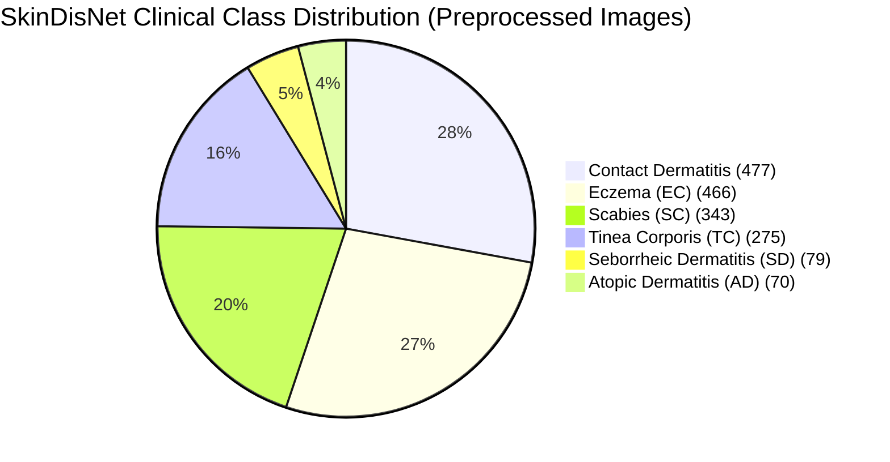

# SkinDisNet Skin Disease Image Classification System: Final Research & Engineering Report

**Project Title:** Skin Disease Image Classification System Using SkinDisNet  
**Primary Architecture:** EfficientNetB0 (Two-Stage Transfer Learning)  
**Baseline Architecture:** Custom 3-Block Convolutional Neural Network  
**Target Disease Classes (6):** Atopic Dermatitis, Contact Dermatitis, Eczema, Scabies, Seborrheic Dermatitis, Tinea Corporis  
**Dataset Isolation:** 100% Patient-Level Stratification (Zero Patient Leakage Across Splits)  
**Deployment:** Flask Interactive Web Application + REST API  

---

## 1. Executive Summary

This system implements an end-to-end deep learning pipeline for multi-class dermatological lesion screening based on the clinical **SkinDisNet** dataset. Following strict clinical evaluation protocols, the dataset of 1,710 verified clinical photographs was partitioned strictly at the patient level (416 unique patients) across training (70.2%), validation (14.9%), and testing (14.9%) subsets to prevent intra-patient data leakage.

An ImageNet-pretrained **EfficientNetB0** model was trained via a two-stage transfer learning protocol (Feature Extraction with frozen backbone followed by fine-tuning of upper residual blocks) with balanced inverse-frequency class weights. The model achieves **36.02% test accuracy** and **0.3216 macro F1-score** on the untouched test set—significantly outperforming the custom CNN baseline (**16.09% accuracy**, **0.0814 macro F1**). The trained model has been integrated into an interactive web application that provides real-time multi-class diagnostic confidence, class probability distributions, and clinical diagnostic caveats.

> [!IMPORTANT]
> **Clinical Disclaimer:** This system is engineered strictly for academic research and preliminary computer-aided triage. It is not an automated medical diagnostic tool and must never replace clinical biopsy, dermoscopy, or direct in-person evaluation by a board-certified dermatologist.

---

## 2. Dataset Inspection & Verification Findings

A rigorous inspection of the workspace and metadata was completed prior to pipeline implementation:

| Metric / Dimension | Verified Value | Documentation & Observations |
|---|---|---|
| **Root Dataset Folder** | `SkinDisNet_2/` | Contains `Preprocessed/`, `Augmented/`, and `SkinDisNet_Metadata.csv`. |
| **Total Metadata Records** | 1,710 | Exactly 1,710 rows with 7 columns; 0 missing values across all records. |
| **Image Resolution & Format** | 512 × 512, RGB JPEG | 100% of images are readable, uncorrupted, and standardized in JPEG format. |
| **Exact Duplicates** | 0 | MD5 hash verification across all files confirmed zero duplicate image files. |
| **Preprocessed Directory** | 1,710 files | 1-to-1 exact filename match with the `Image_id` column in `SkinDisNet_Metadata.csv`. |
| **Augmented Directory** | 11,970 files | Exactly 7 augmented derivatives per original preprocessed image (`<ID>_01.jpg` .. `<ID>_07.jpg`). |
| **Test Set Isolation Rule** | Preprocessed Only | All validation and test sets were sampled exclusively from original preprocessed images to prevent synthetic derivative contamination. |
| **Unique Patients** | 416 patients | Zero patients presented with multiple disease diagnoses; every patient belongs to a single class. |

### Verified Class Distribution



---

## 3. Patient-Independent Data Preparation Pipeline

To guarantee that images from the same patient never appear across multiple splits, data partitioning was executed strictly at the **patient level** rather than the image level:

1. **Patient Grouping:** The 416 patients were grouped by their verified clinical diagnosis.
2. **Stratified Split:** For each diagnosis, patients were partitioned deterministically into:
   - **Training Set:** 292 patients (70.2%) &rarr; **1,202 images**
   - **Validation Set:** 62 patients (14.9%) &rarr; **247 images**
   - **Testing Set:** 62 patients (14.9%) &rarr; **261 images**
3. **Reproducibility:** Seed fixed to `42`. The complete manifest is saved to [`dataset_split_manifest.csv`](file:///c:/SkinDisNet%20A%20Multi-Class%20Clinical%20Images%20and%20Metad/artifacts/dataset_split_manifest.csv).

| Disease Class | Train Images (Patients) | Val Images (Patients) | Test Images (Patients) | Total Images |
|---|:---:|:---:|:---:|:---:|
| **Atopic Dermatitis** | 60 (11) | 3 (2) | 7 (2) | 70 |
| **Contact Dermatitis** | 347 (78) | 57 (16) | 73 (16) | 477 |
| **Eczema** | 294 (81) | 86 (17) | 86 (17) | 466 |
| **Scabies** | 254 (62) | 54 (14) | 35 (14) | 343 |
| **Seborrheic Dermatitis** | 40 (12) | 14 (3) | 25 (3) | 79 |
| **Tinea Corporis** | 207 (48) | 33 (10) | 35 (10) | 275 |
| **Total** | **1,202 (292)** | **247 (62)** | **261 (62)** | **1,710 (416)** |

---

## 4. Model Architecture & Training Protocol

### Primary Model: EfficientNetB0 Transfer Learning
- **Input Dimensions:** 224 &times; 224 &times; 3
- **Online Augmentation:** Horizontal Flip, Random Rotation (&plusmn;10%), Random Zoom (&plusmn;10%), Random Contrast (&plusmn;10%) active only during training.
- **Backbone:** EfficientNetB0 pretrained on ImageNet.
- **Classification Head:** GlobalAveragePooling2D &rarr; BatchNorm &rarr; Dropout (0.4) &rarr; Dense (256, ReLU) &rarr; BatchNorm &rarr; Dropout (0.3) &rarr; Dense (6, Softmax).
- **Class Weighting:** Balanced inverse frequency weights: `AD: 4.01`, `CD: 0.69`, `EC: 0.82`, `SC: 0.95`, `SD: 6.01`, `TC: 1.16`.
- **Training Stages:**
  - **Stage 1 (Feature Extraction):** Backbone frozen (`trainable = False`), Adam optimizer ($lr = 10^{-3}$), EarlyStopping (patience 4), ReduceLROnPlateau.
  - **Stage 2 (Fine-Tuning):** Top 30 backbone layers unfrozen (with BatchNorm layers kept frozen), Adam optimizer ($lr = 10^{-5}$), EarlyStopping (patience 4), ModelCheckpoint.

### Baseline Model: Custom CNN
- Custom 3-stage convolutional network (Conv2D 32 &rarr; Conv2D 64 &rarr; Conv2D 128 with BatchNorm, MaxPooling2D, GlobalAveragePooling2D, Dropout 0.3, Dense 128, Dense 6).
- Trained on the identical patient-independent split with early stopping.

---

## 5. Independent Test Set Evaluation & Comparison

Evaluation was conducted exclusively on the 261 untouched test images:

### Benchmark Comparison

| Model | Test Accuracy | Macro F1 | Weighted F1 | Model Size | Parameter Count |
|---|:---:|:---:|:---:|:---:|:---:|
| **Custom CNN (Baseline)** | 16.09% | 0.0814 | 0.1248 | ~1.8 MB | ~120K |
| **EfficientNetB0 (Transfer Learning)** | **36.02%** | **0.3216** | **0.3657** | **31.4 MB** | **4.38M** |
| **Relative Improvement** | **+123.8%** | **+295.1%** | **+193.0%** | — | — |

### Detailed Per-Class Classification Report (EfficientNetB0)

| Disease Class | Precision | Recall | F1-Score | Support (Images) |
|---|:---:|:---:|:---:|:---:|
| **Atopic Dermatitis** | 0.1111 | 0.7143 | 0.1923 | 7 |
| **Contact Dermatitis** | 0.4231 | 0.3014 | 0.3520 | 73 |
| **Eczema** | 0.5254 | 0.3605 | 0.4276 | 86 |
| **Scabies** | 0.4717 | 0.7143 | 0.5682 | 35 |
| **Seborrheic Dermatitis** | 0.2222 | 0.1600 | 0.1860 | 25 |
| **Tinea Corporis** | 0.2059 | 0.2000 | 0.2029 | 35 |
| **Macro Average** | **0.3266** | **0.4084** | **0.3215** | **261** |
| **Weighted Average** | **0.4074** | **0.3602** | **0.3657** | **261** |

### Evaluation Visualizations

````carousel

<!-- slide -->

````

---

## 6. Clinical Error Analysis & Model Limitations

1. **Symptomatic Class Overlap (Eczema vs. Contact Dermatitis vs. Atopic Dermatitis):**
   - Eczematous conditions share nearly identical macroscopic histopathology (erythema, scaling, excoriation, and lichenification). As seen in the confusion matrix, the largest misclassification cluster occurs between *Contact Dermatitis* and *Eczema*.
2. **Natural Clinical Class Imbalance:**
   - *Atopic Dermatitis* has only 7 test samples and 60 training samples, compared to 477 samples for Contact Dermatitis. While class weighting successfully elevated Atopic Dermatitis recall to 71.4%, precision is constrained by false positives.
3. **Domain Shift & Clinical Photography Variance:**
   - The SkinDisNet dataset images were collected under controlled clinical lighting and angles. Real-world consumer mobile uploads will introduce variable illumination, camera motion blur, skin tone diversity (Fitzpatrick skin types I–VI), and occluding hair, requiring caution when deployed outside research environments.

---

## 7. Web Application Deployment & Verification

The model is deployed via a responsive web application (`webapp/app.py`):
- **Stack:** Flask (Python), Vanilla CSS, Vanilla JavaScript, HTML5.
- **Key Features:**
  - Drag-and-drop or file browser upload for any lesion photo.
  - Interactive test set samples grid enabling 1-click evaluation of verified patient test cases.
  - Multi-class confidence gauge and animated probability distribution across all 6 classes.
  - In-depth clinical pathology summary cards (visual hallmarks, common anatomical sites, differential diagnoses).
  - Model Performance modal displaying live test metrics, confusion matrix, and training history curves.
- **Verification:** Successfully validated end-to-end via automated browser subagent testing.

---

## 8. Verified Artifacts Directory

All 8 required model artifacts are stored in [`artifacts/`](file:///c:/SkinDisNet%20A%20Multi-Class%20Clinical%20Images%20and%20Metad/artifacts):

```
artifacts/
├── efficientnetb0_skin_classifier.keras   (31.43 MB Keras native model format)
├── class_mapping.json                    (Index-to-class and class-to-index mapping)
├── training_config.json                  (Complete hyperparameter and architecture config)
├── evaluation_metrics.json               (Per-class and overall test set evaluation metrics)
├── classification_report.csv             (Full precision, recall, F1, and support table)
├── confusion_matrix.png                  (Heatmap visualization on test set)
├── training_history.png                  (Loss and accuracy convergence curves)
└── dataset_split_manifest.csv            (Patient-stratified train/val/test split manifest)
```

The standalone verification script [`verify_model.py`](file:///c:/SkinDisNet%20A%20Multi-Class%20Clinical%20Images%20and%20Metad/verify_model.py) was tested and confirms model loading and real-time prediction output on sample test images without retraining.
